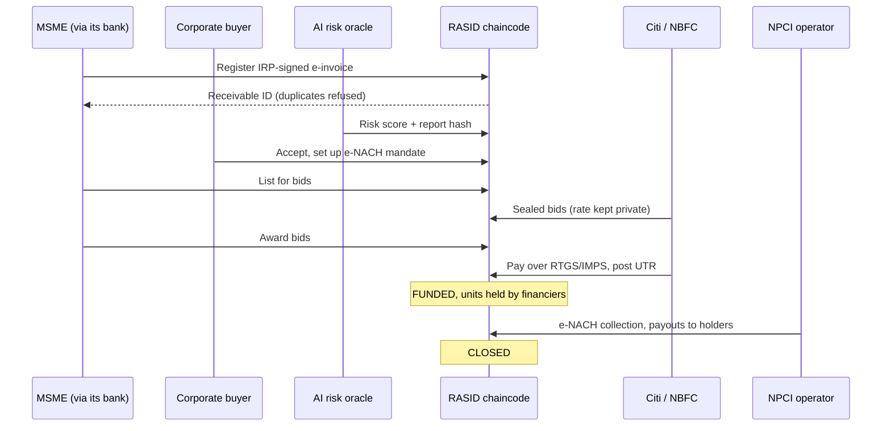
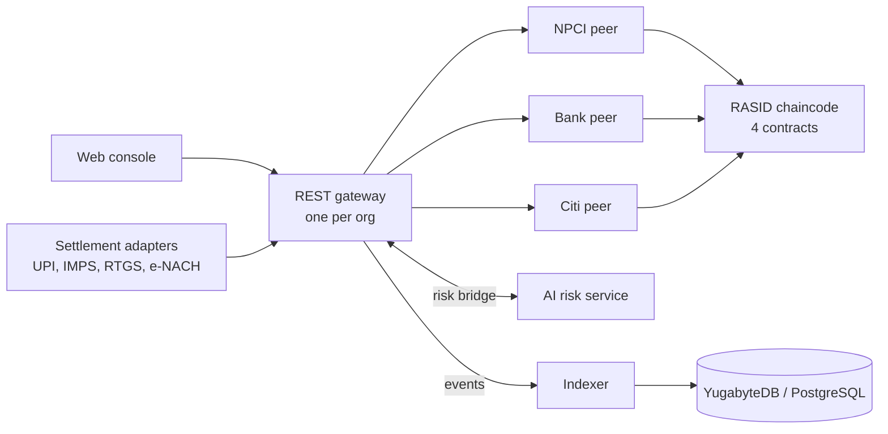

# RASID

**Fraud-proof, tokenized MSME invoices on DRUNIX.** RASID turns GST
e-invoices into receivable tokens on a shared ledger. Banks and NBFCs bid on
them privately, AI flags fake and circular invoices before anyone pays, and
funding and repayment settle over UPI, IMPS, RTGS and e-NACH.

Built by team **ARD** for the Citi × NPCI DRUNIX Hackathon (Innovation
Carnival, challenge CHL-7007).

## The problem

MSMEs wait 60 to 120 days to be paid, and invoice finance should bridge that
gap. Lenders hold back because they cannot verify invoices. Every bank, NBFC
and TReDS platform keeps its own books, so nothing stops the same invoice from
being financed twice, or a fabricated or circular invoice from being financed
at all. Funding, repayment and payouts to several lenders are then reconciled
by hand.

## What RASID does

1. **One invoice, one token.** The chaincode verifies the GST IRP signature on
   the e-invoice and derives a network-wide unique key from the seller's GSTIN,
   the document number and the financial year. A second registration of the same
   invoice, by any bank and by either route, is refused.
2. **The buyer confirms it.** The corporate buyer accepts the invoice on chain
   before it can be financed.
3. **AI scores it.** A risk oracle looks across the whole invoice network for
   circular trading, re-issued near-duplicates, velocity spikes and late-paying
   buyers. It anchors the score and a hash of its report on chain, and the
   chaincode will not list or award a receivable above the risk limit.
4. **Banks bid privately.** Financiers submit sealed bids. The rate travels
   only in Fabric's transient data and the bidder's private collection; the
   shared ledger holds a hash. The MSME awards one or several bids.
5. **Settlement is automatic.** Each receivable is 10,000 units. Financiers pay
   over RTGS, IMPS or UPI and post the UTR; units move to them and the invoice
   becomes FUNDED. Units can be sold on between financiers. The buyer's e-NACH
   mandate repays, and payouts go to every holder pro rata.



## Architecture



Each organisation runs its own gateway with its own certificate, so every
transaction is signed by the right party. Roles (supplier, buyer, financier,
risk oracle, operator) and GSTINs come from attributes in the Fabric CA
certificate, and the operator and risk-oracle roles only count from the
organisations named when the ledger is initialised.

## Who can do what

Access is checked in three places, and the first is the one that counts:

1. **The ledger.** Every chaincode function checks the signer's role and, for
   suppliers and buyers, their GSTIN, all read from the certificate. Only the
   buyer named on an invoice can accept it, only its supplier can list or
   award it, and only the financier that won a bid can pay for it.
2. **The server.** Each sign-in acts as exactly one identity, chosen by the
   server: a devnet account maps to an identity, and a live gateway signs
   with its organisation's certificate. A request without a sign-in gets 401,
   and nothing in the browser can change who a request acts as.
3. **The screen.** Each party gets its own workspace with only the actions its
   role allows at that stage. That is for usability; the two layers above are
   the security.

## Repository layout

| Path | What it is |
|---|---|
| `chaincode/rasid/` | Go chaincode: InvoiceRegistry, Marketplace, ReceivableToken, Settlement |
| `ai/risk-service/` | Fraud and risk scoring service (Python, standard library) |
| `app/gateway/` | REST gateway on the Fabric Gateway SDK, with the risk bridge |
| `app/devnet/` | The real chaincode on an in-memory ledger, same API as the gateway |
| `app/web/` | Web console: sign-in, one screen per party |
| `adapters/payments/` | Mock UPI, IMPS, NEFT, RTGS and e-NACH settlement adapters |
| `analytics/` | Event indexer and SQL for YugabyteDB or PostgreSQL |
| `network/local/` | A 3-org Fabric 2.5 network (NPCI, BankA, Citi) without Docker |
| `network/deploy-chaincode.sh` | Chaincode deployment for a DRUNIX network |
| `tools/mock-irp/` | Mock GST IRP that issues signed e-invoice QR codes |
| `tools/issue-identity/` | Issues certificates carrying RASID roles and GSTINs |
| `benchmarks/caliper/` | Hyperledger Caliper workloads and results |
| `scripts/` | End-to-end demos for devnet and the live network |

The main components have their own README; the tools and scripts explain
themselves in a comment at the top of each file.

## Quick start

Needs Go 1.24+, Python 3.9+, curl and jq. On a Mac: `brew install go jq`.

```bash
bash scripts/demo-devnet.sh
```

That runs the whole flow in about ten seconds: it registers a ₹10,00,000
e-invoice, blocks a duplicate, scores it, takes sealed bids from Citi and an
NBFC, funds it, moves units between financiers, collects through e-NACH and
pays both holders, ending CLOSED.

To click through it, run `bash scripts/console-devnet.sh`, which starts the
devnet with the AI risk service scoring every new invoice. Open
http://localhost:8080 and sign in, for example as `msme` with the demo
password `rasid`, using one browser tab per party.
[TESTING.md](TESTING.md) has every step, including the unit tests and the live
Fabric network.

## Results so far

- **Tests:** 14 chaincode tests, plus the devnet, gateway, risk service,
  adapter and indexer suites, all passing.
- **Live network:** on the local 3-org Fabric 2.5 network, five gateways (one
  per role) ran the full flow to CLOSED. A Citi certificate claiming the NPCI
  operator role was refused on chain.
- **Console:** every party signed in in its own tab and clicked one invoice
  from registration to CLOSED, on the devnet and on the live network.
- **Benchmark smoke run** (Caliper 0.6, everything on one 4-vCPU machine, 0
  failures):

| Workload | Transactions | Throughput | Avg latency |
|---|---|---|---|
| Register e-invoice (signature check, 2-org endorsement) | 1,502 | 49.6 TPS | 0.32 s |
| Month-end spike | 2,628 | 87.4 TPS | 0.34 s |
| Duplicate check (read-only) | 4,002 | 200.1 TPS | 0.00 s |

These numbers check correctness and plumbing; the load generator shared the
machine with every node, so they are not a DRUNIX performance claim.

## Where DRUNIX comes in

The code targets the Fabric v2 lifecycle and Gateway API that DRUNIX keeps, so
it deploys to DRUNIX unchanged with `network/deploy-chaincode.sh`. The design
uses DRUNIX's own features:

- **Lite and committing peers** absorb month-end registration spikes.
- **The stateless validation service** keeps signature and policy checks fast
  under load.
- **The KeyDB transient store and private data** keep bid rates out of the
  shared payload.
- **YugabyteDB** serves SQL analytics over the registry.
- **Falcon** deploys the network on Kubernetes so a new bank can join quickly.

## Status and limits

- So far everything has run on stock Hyperledger Fabric 2.5, not yet on DRUNIX,
  so the DRUNIX-only features above are untested.
- The risk service is a rule-and-graph baseline, not a trained model. Its
  synthetic results (precision 0.98, recall 1.0) come from data shaped like its
  own detectors, so they show the pipeline works, not real-world accuracy.
- The GST IRP and payment rails are mocks with the real message shapes.
- Sign-in is a stand-in for each bank's own single sign-on: demo accounts with
  a shared password, held in memory or a JSON file.
- Award amounts are public, so a rate could be inferred from them; moving
  awards into a supplier–financier private collection is the next privacy step.
