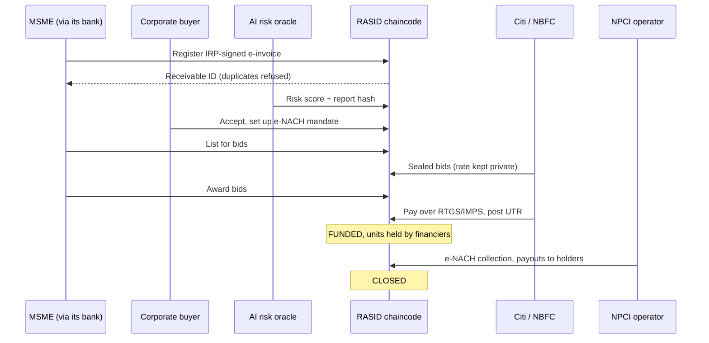
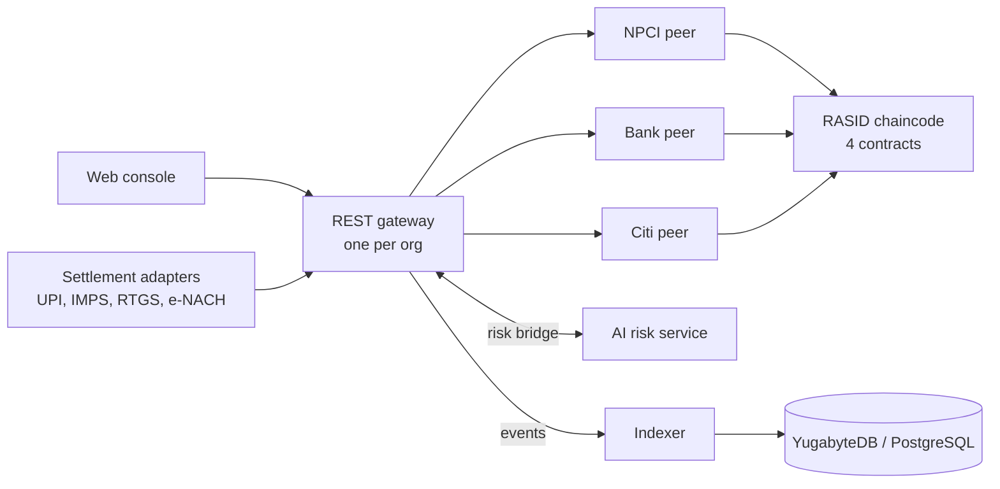

# RASID

**Fraud-proof, tokenized MSME invoices on DRUNIX.** RASID turns GST
e-invoices into receivable tokens on a shared ledger. Banks and NBFCs bid on
them privately, AI flags fake and circular invoices before anyone pays, and
funding and repayment settle over UPI, IMPS, RTGS and e-NACH.

Built by team **ARD** for the Citi × NPCI DRUNIX Hackathon (Innovation
Carnival, challenge CHL-7007).

## The problem

MSMEs wait 60 to 120 days to be paid, and invoice finance should bridge that
gap. Lenders hold back because they cannot verify invoices. Every bank, NBFC
and TReDS platform keeps its own books, so nothing stops the same invoice from
being financed twice, or a fabricated or circular invoice from being financed
at all. Funding, repayment and payouts to several lenders are then reconciled
by hand.

## What RASID does

1. **One invoice, one token.** The chaincode verifies the GST IRP signature on
   the e-invoice and derives a network-wide unique key from the seller's GSTIN,
   the document number and the financial year. A second registration of the same
   invoice, by any bank and by either route, is refused.
2. **The buyer confirms it.** The corporate buyer accepts the invoice on chain
   before it can be financed.
3. **AI scores it.** A risk oracle looks across the whole invoice network for
   circular trading, re-issued near-duplicates, velocity spikes and late-paying
   buyers. It anchors the score and a hash of its report on chain, and the
   chaincode will not list or award a receivable above the risk limit.
4. **Banks bid privately.** Financiers submit sealed bids. The rate travels
   only in Fabric's transient data and the bidder's private collection; the
   shared ledger holds a hash. The MSME awards one or several bids.
5. **Settlement is automatic.** Each receivable is 10,000 units. Financiers pay
   over RTGS, IMPS or UPI and post the UTR; units move to them and the invoice
   becomes FUNDED. Units can be sold on between financiers. The buyer's e-NACH
   mandate repays, and payouts go to every holder pro rata.



## Architecture



Each organisation runs its own gateway with its own certificate, so every
transaction is signed by the right party. Roles (supplier, buyer, financier,
risk oracle, operator) and GSTINs come from attributes in the Fabric CA
certificate, and the operator and risk-oracle roles only count from the
organisations named when the ledger is initialised.

## Who can do what

Access is checked in three places, and the first is the one that counts:

1. **The ledger.** Every chaincode function checks the signer's role and, for
   suppliers and buyers, their GSTIN, all read from the certificate. Only the
   buyer named on an invoice can accept it, only its supplier can list or
   award it, and only the financier that won a bid can pay for it.
2. **The server.** Each sign-in acts as exactly one identity, chosen by the
   server: a devnet account maps to an identity, and a live gateway signs
   with its organisation's certificate. A request without a sign-in gets 401,
   and nothing in the browser can change who a request acts as.
3. **The screen.** Each party gets its own workspace with only the actions its
   role allows at that stage. That is for usability; the two layers above are
   the security.

## Repository layout

| Path | What it is |
|---|---|
| `chaincode/rasid/` | Go chaincode: InvoiceRegistry, Marketplace, ReceivableToken, Settlement |
| `ai/risk-service/` | Fraud and risk scoring service (Python, standard library) |
| `app/gateway/` | REST gateway on the Fabric Gateway SDK, with the risk bridge |
| `app/devnet/` | The real chaincode on an in-memory ledger, same API as the gateway |
| `app/web/` | Web console: sign-in, one screen per party |
| `adapters/payments/` | Mock UPI, IMPS, NEFT, RTGS and e-NACH settlement adapters |
| `analytics/` | Event indexer and SQL for YugabyteDB or PostgreSQL |
| `network/drunix/` | Runs RASID on NPCI's DRUNIX test network: setup, up, deploy, inspect, down |
| `network/local/` | A 3-org Fabric 2.5 network (NPCI, BankA, Citi) without Docker |
| `network/deploy-chaincode.sh` | Chaincode deployment for any Fabric-compatible network |
| `docs/drunix/` | What we found running on DRUNIX, and a fix to send upstream |
| `tools/mock-irp/` | Mock GST IRP that issues signed e-invoice QR codes |
| `tools/issue-identity/` | Issues certificates carrying RASID roles and GSTINs |
| `benchmarks/caliper/` | Hyperledger Caliper workloads and results |
| `scripts/` | End-to-end demos for devnet and the live network |

The main components have their own README; the tools and scripts explain
themselves in a comment at the top of each file.

## Quick start

Needs Go 1.24+, Python 3.9+, curl and jq. On a Mac: `brew install go jq`.

```bash
bash scripts/demo-devnet.sh
```

That runs the whole flow in about ten seconds: it registers a ₹10,00,000
e-invoice, blocks a duplicate, scores it, takes sealed bids from Citi and an
NBFC, funds it, moves units between financiers, collects through e-NACH and
pays both holders, ending CLOSED.

To click through it, run `bash scripts/console-devnet.sh`, which starts the
devnet with the AI risk service scoring every new invoice. Open
http://localhost:8080 and sign in, for example as `msme` with the demo
password `rasid`, using one browser tab per party. On the devnet the MSME can
create a signed sample e-invoice from the console, so the demo needs no
terminal.

To check that everything still works after a change:

```bash
bash scripts/check.sh
```
[TESTING.md](TESTING.md) has every step, including the unit tests and the live
Fabric network.

## Results so far

- **On DRUNIX:** on NPCI's DRUNIX test network, brought up from scratch, five
  gateways (one per role) ran the full flow to CLOSED in under 30 seconds.
  Lite peers endorsed it, committing peers committed it, YugabyteDB holds the
  state as SQL rows, and the sealed bid went through KeyDB as private data.
  See [Where DRUNIX comes in](#where-drunix-comes-in).
- **Checks:** `bash scripts/check.sh` runs 16 checks and must pass after
  every change; GitHub Actions runs it on every push. They cover formatting,
  `go vet`, shell and JavaScript syntax, a scan for committed private keys,
  74 unit tests (14 chaincode, 14 devnet, 9 gateway, 27 risk service, 6
  adapters, 4 indexer) under Go's race detector, the end-to-end demo, and a
  headless-browser run of the console from registration to CLOSED.
- **Fraud model:** the trained model rasid-gam-1.0 reaches ROC-AUC 0.95 and
  0.90 precision on held-out simulated networks, against 0.80 and 0.36 for the
  old rules. See [`ai/risk-service/MODEL_CARD.md`](ai/risk-service/MODEL_CARD.md).
- **Security suite:** every role is tried against every state-changing
  function and must get 403 wherever the rules forbid it, without changing
  the ledger. It also checks that one bank cannot read another's sealed bid,
  that every ledger endpoint needs a sign-in, the security headers, the 1 MB
  body cap and the sign-in lockout.
- **Live network:** on the local 3-org Fabric 2.5 network, five gateways (one
  per role) ran the full flow to CLOSED. A Citi certificate claiming the NPCI
  operator role was refused on chain.
- **Console:** every party signed in in its own tab and clicked one invoice
  from registration to CLOSED, on the devnet and on the live network.
- **Benchmark smoke runs** (Caliper 0.6, everything on one 4-vCPU machine, 0
  failures), on DRUNIX and on the local Fabric network:

| Workload | Transactions | DRUNIX throughput | DRUNIX avg latency | Local Fabric throughput | Local avg latency |
|---|---|---|---|---|---|
| Register e-invoice (signature check, 2-org endorsement) | 1,502 | 48.5 TPS | 2.17 s | 49.6 TPS | 0.32 s |
| Month-end spike (ramp 50 → 300 TPS) | 2,230 / 2,628 | 56.4 TPS | 5.33 s | 87.4 TPS | 0.34 s |
| Duplicate check (read-only) | 4,002 | 200.0 TPS | 0.01 s | 200.1 TPS | 0.00 s |

On DRUNIX the committing peers set the pace: about 0.9 s per block to
validate and write state to YugabyteDB, with twelve containers and the load
generator sharing 4 vCPUs. These numbers check correctness and plumbing, not
DRUNIX's performance; see [`benchmarks/caliper/results/`](benchmarks/caliper/results/).

## Where DRUNIX comes in

RASID runs on NPCI's DRUNIX test network (two organisations: Org1MSP plays
NPCI, Org2MSP plays Citi with the supplier and buyer it enrols). Each part of
DRUNIX does real work in the flow:

- **Lite peers** run the chaincode and endorse every transaction. They keep
  no ledger, which keeps endorsement load (month-end registration spikes) off
  the peers that commit.
- **Committing peers** validate and commit blocks, and the REST gateways read
  events and commit status from them.
- **The stateless validation service** checks endorsement policies for the
  committing peers.
- **YugabyteDB** holds the world state as SQL rows, so the registry can be
  queried with plain SQL (`network/drunix/inspect.sh` shows the latest
  receivables straight from each organisation's database).
- **The KeyDB transient store** carries each sealed bid as private data;
  only its hash goes on the shared ledger.

Falcon, DRUNIX's Kubernetes deployer, is not in the public repository, so
RASID doesn't use it yet.

```bash
bash network/drunix/setup.sh
bash network/drunix/up.sh
bash network/drunix/deploy.sh
bash scripts/demo-drunix.sh
bash network/drunix/inspect.sh
```

`setup.sh` fetches DRUNIX and its images once; `up.sh` starts the network;
`deploy.sh` installs RASID as a chaincode service, issues identities and
initialises the ledger. `scripts/console-drunix.sh` opens the web console on
the same network, and `network/drunix/down.sh` removes it.

Running on DRUNIX turned up six issues in DRUNIX 1.0.0. The most serious is a
deadlock that stops a committing peer. RASID works around each one, and we
wrote an upstream fix for the deadlock. All six are in
[`docs/drunix/findings.md`](docs/drunix/findings.md).

## Status and limits

- RASID has run on DRUNIX's two-organisation test network on one machine,
  not on a multi-host DRUNIX deployment.
- The fraud model is trained and tested on simulated trade networks, because
  no labelled GST invoice-fraud data is public. Its numbers show how it
  ranks fraud against honest look-alikes, not real-world accuracy.
- The GST IRP and payment rails are mocks with the real message shapes.
- Sign-in is a stand-in for each bank's own single sign-on: demo accounts with
  a shared password, held in memory or a JSON file.
- Award amounts are public, so a rate could be inferred from them; moving
  awards into a supplier–financier private collection is the next privacy step.
